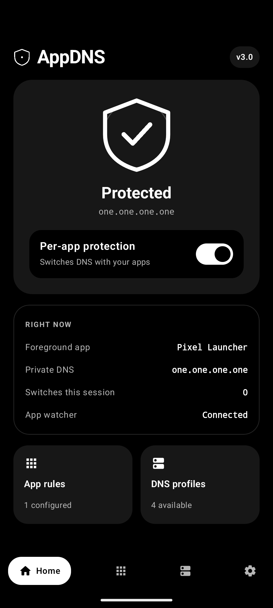
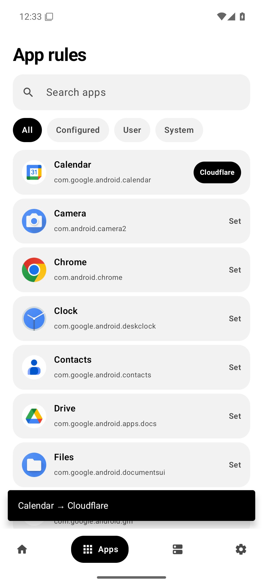
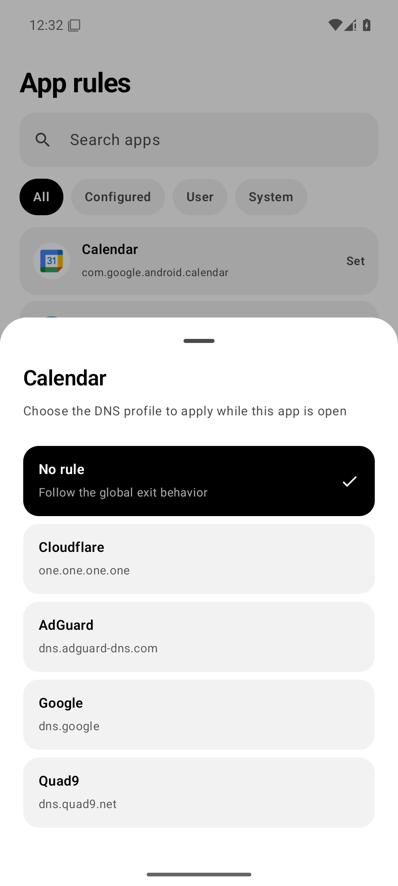
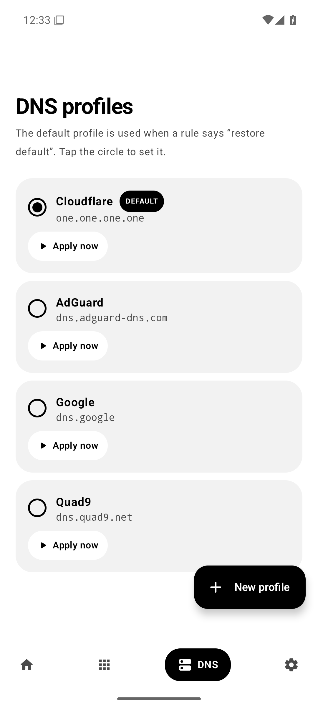
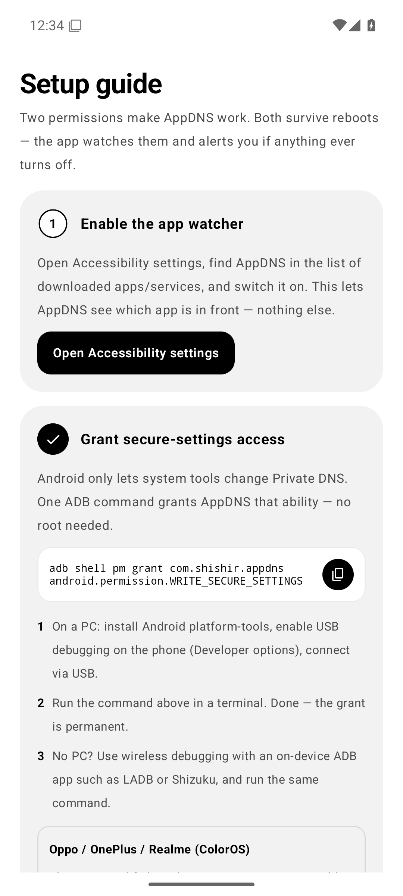
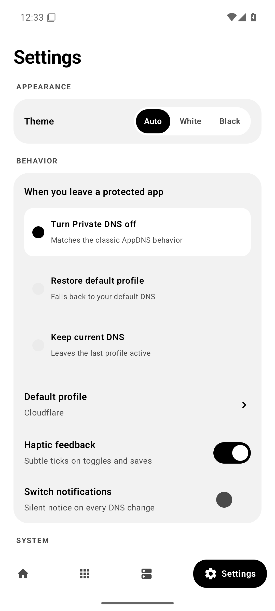

<div align="center">

# AppDNS

**Per-app Private DNS switcher for Android — no root, no VPN.**

Automatically changes Android's native Private DNS (DNS-over-TLS) when you open an app, and turns it off when you leave.

[](https://github.com/Shishir-ip/AppDNS/releases/latest)
[](https://github.com/Shishir-ip/AppDNS)
[](LICENSE)

<br>

<a href="https://github.com/Shishir-ip/AppDNS/releases/latest/download/AppDNS.apk">
  
</a>

<sub>Free · Open source · ~2.3 MB · Works with AdGuard, Cloudflare, NextDNS, Quad9 & any DoT provider</sub>

<br><br>





</div>

---

## What is AppDNS?

AppDNS lets you pick a **different Private DNS provider for each app**. Open your browser → AdGuard blocking turns on. Leave it → DNS turns back off. It writes directly to Android's built-in Private DNS setting, so there is **no VPN, no always-on notification, and no battery drain** — your real VPN (WireGuard, Tailscale, work VPN) keeps working.

- ⚡ **Instant switching** — DNS changes in under 10 ms after an app opens (event-driven, zero polling)
- 🎯 **Per-app rules** — assign any DNS profile to any app, with search & filters
- 🛡️ **Built-in providers** — Cloudflare, AdGuard, Google, Quad9 + unlimited custom DoT hostnames (NextDNS, Control D, Mullvad…)
- 🔄 **Smart exit behavior** — turn DNS off, restore your default, or keep it when you leave an app
- 🚨 **Permission watchdog** — alerts you with a notification if a reboot or update ever disables a permission
- 🎨 **Clean black & white design** — two themes, smooth spring animations, haptic feedback
- ⬆️ **In-app updates** — check, download with live progress, and install new versions without leaving the app
- 🔒 **Private by design** — no analytics, no tracking; the accessibility service reads only the foreground app's package name, never screen content

## Screenshots

<div align="center">




</div>

## Install & Setup (2 minutes)

1. **Download** the APK with the button above and install it (allow "install unknown apps" if asked).
2. **Enable the app watcher:** open AppDNS → Setup guide → *Open Accessibility settings* → turn on **AppDNS**.
3. **Grant the DNS permission once** (no root needed). Connect your phone to a PC with USB debugging enabled and run:

   ```bash
   adb shell pm grant com.shishir.appdns android.permission.WRITE_SECURE_SETTINGS
   ```

   No PC? Use wireless debugging with an on-device ADB app like **LADB** or **Shizuku** — the Setup screen has a copy button for the command.

4. Go to **Apps**, tap any app, choose its DNS profile. Done.

> **Oppo / OnePlus / Realme (ColorOS):** if the command fails with `SecurityException: Neither user 2000...`, enable **Developer options → "Disable permission monitoring" or "Disable system optimization" **, restart the phone, and run the command again.

## How it works

AppDNS listens for Android's window-change events (accessibility) and writes `private_dns_mode` / `private_dns_specifier` in `Settings.Global` — the same setting you find in *Settings → Network → Private DNS*. Android's own network stack handles the encrypted DNS-over-TLS connection. Rules are kept in memory, so switching is a single fast system write with no database or network involved.

**Note:** Private DNS is a system-wide setting. While a protected app is in front, the whole device uses that DNS provider — background apps resolve through it too. AppDNS is a privacy convenience, not a security boundary.

## FAQ

**Does it use a VPN?** No — your VPN slot stays free.
**Does it need root?** No — one ADB command (or Shizuku/LADB) is enough.
**Which DNS providers work?** Any DNS-over-TLS hostname: AdGuard, Cloudflare, NextDNS (`<id>.dns.nextdns.io`), Quad9, Control D, Mullvad, or your own server.
**Does it drain battery?** No polling — it reacts to app-switch events and goes idle.
**Will it survive a reboot?** Yes. If anything ever gets disabled, AppDNS notifies you and shows a fix-it banner.

## Build from source

Requirements: JDK 17+, Android SDK (platform 35), Gradle 8.9+.

```bash
git clone https://github.com/Shishir-ip/AppDNS.git
cd AppDNS
# put your keystore at ./appdns-v3.keystore, set sdk.dir in local.properties
gradle :app:assembleRelease
```

## Credits

Designed & built by **Shishir** · [GitHub](https://github.com/Shishir-ip)

Licensed under the [Apache License 2.0](LICENSE).

<sub>Keywords: android private dns per app, auto switch private dns, dns over tls switcher, adguard dns per app, cloudflare dns android, nextdns android, change private dns adb, write_secure_settings dns, no root dns changer, appdns apk</sub>
